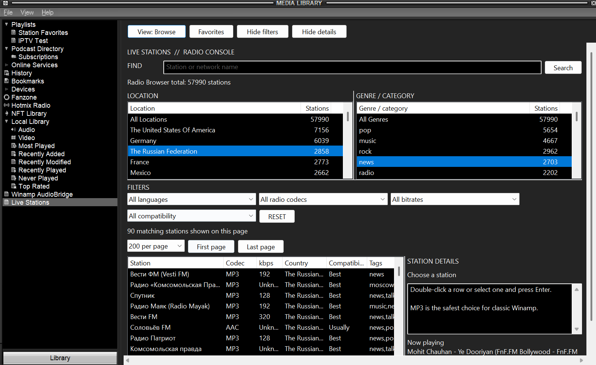

# Live Stations — radio UI beta

A native Winamp Media Library radio browser with saved Favorites, filters,
bounded paging, sortable columns and resizable category/details panes.

[Download v0.1.0-beta.1](https://github.com/JeremiahFD/winamp-tools/releases/tag/live-stations-v0.1.0-beta.1)
 · [Short installation notes](UI_RELEASE.md)



## Build and checks

Use Windows with Visual Studio C++ x86 build tools and the Windows SDK:

```powershell
.\build.ps1 -Configuration Release -UiOnly
$out = '.\build\x86\release\radio-ui'
& "$out\live_stations_contracts_probe.exe"
& "$out\plugin_abi_probe.exe" "$out\ml_livestations.dll"
& "$out\plugin_host_probe.exe" "$out\ml_livestations_fixture.dll" --skin-only
& "$out\plugin_host_probe.exe" "$out\ml_livestations_fixture.dll" --full-fixture
```

Run checks sequentially and stop if any exit code is nonzero. The fixture DLL is
test-only: **never install it**. It supplies deterministic data without provider
network access. Running the host probe against the normal DLL can contact Radio
Browser, even in skin-only mode.

The published binary passed a Release build, contracts/Favorites, ABI, skin and
full-fixture checks; an owner also reported it working in Winamp 5.9.2. This is
not exhaustive skin, scaling, decoder or long-run crash certification.

Only the UI-only build is supported on this release branch. Two inert headers
remain for existing compile/test dependencies; no resolver or chat service is
included. Video and companion implementations remain outside this release.

Possible next steps: a companion that refreshes saved playlist station links,
video streams with suitable playback support, and a separate optional station
chat plug-in. These are future ideas, not included features or release promises.

The ZIP contains the normal DLL and short instructions/license notices only.
Radio Browser directory data and stream availability are external to the plug-in.
Original code is [MIT-licensed](../LICENSE); retained Winamp interoperability
declarations have their own [notice](THIRD_PARTY_NOTICES.txt).
